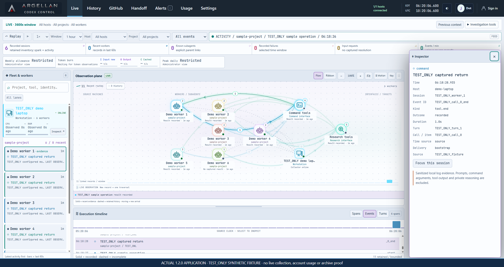
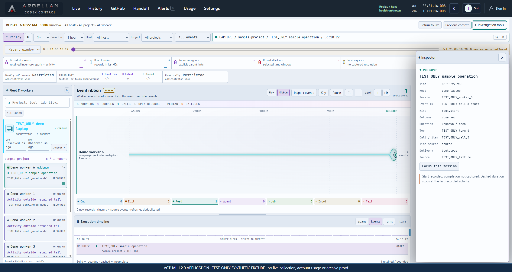
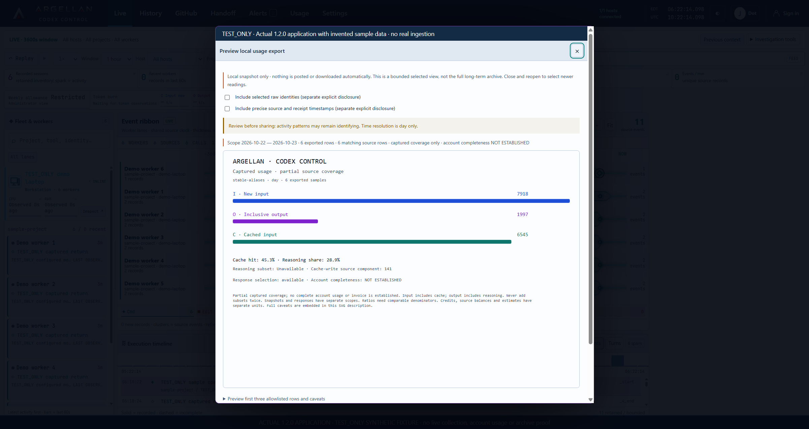

# Actual application demonstration
<!--
Author: Bishop Crockett
Owner: Argellan.com
License: MIT
SPDX-License-Identifier: MIT
Attribution covers ARGELLAN-authored implementation and modifications only.
Upstream credits and licenses remain in THIRD_PARTY_NOTICES.md.
-->

This is the actual 1.2.0 application with invented sample data, recorded on 23 October 2026. It demonstrates presentation and local review controls. It does not qualify real account collection, collector enrollment, native ingestion, archive transfer, host lifecycle behavior or the final integrated release.

Source baseline: `2021b98241e208305960008e6c0e6aa026a207e3`. Runtime JavaScript in the recorded staging copy was unchanged from that original baseline. The staged copy uses the supplied final ARGELLAN SVGs, byte for byte. Capture-only labels identify the synthetic boundary; they are not product features. Product naming and version policy remain unchanged.

Integration note: these original captures are included unchanged in local rc3 based on `8a3c532e1b4fb323649b00b07fa3b5a4e14cb55d`. Their JavaScript, CSS and HTML inputs and supplied SVG artwork are byte-bound during integration. This preserves presentation applicability; it does not turn the recording into a fresh rc3 runtime or platform qualification.

## Applicability review after accepted source integration

Text review against `8a3c532e1b4fb323649b00b07fa3b5a4e14cb55d` found all 56 baseline `public/` files unchanged, supporting reuse of these explicitly dated presentation captures. The server and query adapters changed for optional analytics; no new app/collector test or recapture occurred in this review. These screenshots, captions and video keep their original source binding. They do not demonstrate archive analytics, a validated release register or acceptance of sealed rc3.

## Screenshots

Actual application, synthetic fixture. The selected record is `TEST_ONLY_call_0_end`; its return is recorded, not independently accepted.

Replay is an evidence view. Historical host health remains unknown and replay does not resume a task.

One response lacks a reasoning counter. Its complete response sum stays unavailable. Ratios use their own comparable input coverage and do not establish billing or account completeness.

## Normal-speed walkthrough

[Watch the local walkthrough](media/walkthrough.mp4), with [WebVTT captions](media/walkthrough.vtt) and a [text transcript](media/walkthrough-transcript.md).

The uncut master is 89.6562 seconds, 2402 x 1274 pixels, AV1 at nominal 30 fps. The playback copy is H.264, 89.7 seconds, with no cuts, acceleration, synthetic voice or audio track. Encoding/frame rounding accounts for the small duration difference. These recording settings are not a product frame-rate measurement.

Chrome 156.0.0.0 on Windows x64 used an isolated browser context at `1922 x 1020` CSS pixels and device-pixel ratio 1.25. Screenshots are `2402 x 1275` pixels. No existing user tab, production database, source log, actual quota or account credential was used. The fixture contains 11 invented event records and six invented usage rows, including one incomplete call and one absent reasoning counter.

The sequence shows linked event selection, Flow zoom/Fit, a Research filter, an incomplete operation, Ribbon zoom/Fit, Replay, return to Live and a local export preview. The two disclosure choices stay off. No export download or external posting occurs in the clip. It does not show actual sign-in, physical touch, native Safari, a collector or an archive receiver. It is a desktop capture; physical phone-size legibility is unqualified.

Capture and source receipts are retained privately with the preparation job. The final integrated tuple, final public destination and Owner publication decision remain separate. Local files here are real artifacts; no public video or release-download URL is implied.
